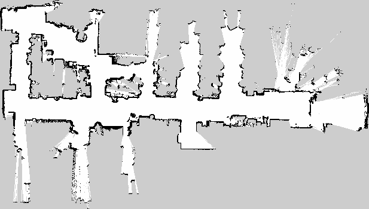

# second_project — SLAM Mapping and Autonomous Navigation (ROS 2, Nav2)

ROS 2 (ament_cmake / C++ + Python launch) package covering two tasks:

1. **Mapping** — build a 2D occupancy grid offline from a recorded rosbag of a UGV carrying a 3D LiDAR, using `pointcloud_to_laserscan` + **SLAM Toolbox**.
2. **Navigation** — load the resulting map into a **Stage** simulation of a Scout Mini, localise with **AMCL**, and drive through a list of goals read from a CSV file using **Nav2**.

Developed for the Robotics course at Politecnico di Milano (second project).



## Pipeline

```
Task 1 — mapping
  rosbag ─► /ugv/rslidar_points (PointCloud2)
              └─► pointcloud_to_laserscan ─► /base_scan (LaserScan)
                                                └─► slam_toolbox (async) ─► /map ─► map_saver ─► maps/my_map.{pgm,yaml}

Task 2 — navigation
  maps/my_map.pgm ─► Stage (scout_world.world) ─► /base_scan, /odom, /tf, /clock
  maps/my_map.yaml ─► map_server ─► /map ─┐
  /base_scan ─────────────────────────────┴► AMCL ─► map → odom
  goals.csv ─► goal_publisher_node ─► NavigateToPose action ─► Nav2 (NavFn + DWB) ─► /cmd_vel ─► Stage
```

## Repository layout

```
second_project/
├── CMakeLists.txt
├── package.xml
├── config/
│   ├── slam_toolbox.yaml              # SLAM Toolbox (mapping mode, Ceres solver)
│   ├── pointcloud_to_laserscan.yaml   # 3D → 2D projection parameters
│   ├── nav2.yaml                      # AMCL, map_server, planner, controller, costmaps, BT, ...
│   ├── mapping.rviz
│   └── navigation.rviz
├── launch/
│   ├── mapping.launch.py              # Task 1
│   └── navigation.launch.py           # Task 2
├── maps/
│   ├── my_map.pgm / my_map.yaml       # map used by Nav2 and Stage
│   ├── my_map.png                     # preview only
│   ├── scout_world.world              # Stage world (loads my_map.pgm)
│   └── scout_mini.inc                 # Scout Mini + 360° ranger definition
├── csv/goals.csv                      # navigation goals (x, y, yaw)
└── src/goal_publisher_node.cpp        # CSV → NavigateToPose action client
```

## Dependencies

| Package | Used for |
|---------|----------|
| `rclcpp`, `rclcpp_action`, `geometry_msgs`, `nav2_msgs`, `nav_msgs`, `sensor_msgs`, `tf2*` | build-time (goal publisher) |
| `pointcloud_to_laserscan` | 3D → 2D conversion |
| `slam_toolbox` | mapping |
| `nav2_bringup`, `nav2_amcl`, `nav2_map_server`, `nav2_lifecycle_manager` | localisation and navigation |
| `stage_ros2_stageros` (Stage for ROS 2, as referenced in `package.xml`) | simulation |
| `rviz2` | visualisation |

A ROS 2 distribution with Nav2 and SLAM Toolbox available (e.g. Humble) is assumed; adjust to the version you tested on.

## Build

```bash
mkdir -p ~/ws/src && cd ~/ws/src
git clone <this-repo-url> second_project
cd ~/ws
rosdep install --from-paths src --ignore-src -r -y
colcon build --packages-select second_project
source install/setup.bash
```

## Task 1 — Mapping

The bag is **not** included in this repository. It is replayed in real time with `--clock`.

```bash
ros2 launch second_project mapping.launch.py bag_file:=/absolute/path/to/rosbag2_dir
```

This starts the bag player, `pointcloud_to_laserscan`, `async_slam_toolbox_node` and RViz (`mapping.rviz`).

Key configuration facts (all verified against the recorded bag):

* Input cloud `/ugv/rslidar_points` → output scan `/base_scan` (remapped).
* Frames: `UGV_odom` → `UGV_base_link` (`/tf`), `UGV_base_link` → `rslidar` (`/tf_static`).
* Height slice in the sensor frame: `[-0.4, 0.5] m` (sensor ~0.5 m above ground) → floor and ceiling returns are rejected.
* 720 beams (0.5° resolution), range 0.2–20 m, `scan_time = 0.2 s` (the LiDAR runs at ≈5 Hz in this bag; a wrong value corrupts scan timestamps).
* SLAM Toolbox: Ceres solver, loop closing enabled, 5 cm resolution.

**Saving the map** once the bag has finished playing:

```bash
ros2 run nav2_map_server map_saver_cli -f src/second_project/maps/my_map
```

This produces `my_map.pgm` and `my_map.yaml` (resolution 0.05 m/px, origin `[-6.86, -12.7, 0]`).

Optionally, the full SLAM Toolbox pose graph can be serialised (needed only to continue mapping or run SLAM Toolbox in localisation mode; **not** needed for Task 2):

```bash
ros2 service call /slam_toolbox/serialize_map slam_toolbox/srv/SerializePoseGraph "{filename: '/absolute/path/my_map'}"
```

## Task 2 — Navigation

```bash
ros2 launch second_project navigation.launch.py
```

Started components:

| Component | Purpose |
|-----------|---------|
| `stageros` + `scout_world.world` | Simulated Scout Mini with 360° / 720-sample LiDAR (0.1–20 m), noisy odometry (`odom_error [0.05 0.05 0 0.02]`), omnidirectional drive |
| `map_server`, `amcl`, `lifecycle_manager_localization` | Static map + particle-filter localisation (`map → odom`) |
| Nav2 `navigation_launch.py` | NavFn planner, DWB controller, smoother, behaviours, BT navigator, velocity smoother, waypoint follower |
| `goal_publisher_node` (delayed 10 s) | Sends the goals from `csv/goals.csv` sequentially |
| `rviz2` | `navigation.rviz` |

### Goals

`csv/goals.csv` (header required, one goal per line, `map` frame, yaw in radians):

```csv
x,y,theta
1.6,-4.4,-0.013
12.3,-4.0,1.513
...
```

Behaviour of `goal_publisher_node`:

* Waits up to 30 s for the `navigate_to_pose` action server, then loads the CSV (malformed lines are skipped with a warning).
* Sends goals **one at a time**. The next goal is sent 1 s after the previous one **succeeds, aborts, is cancelled or is rejected** — a failed goal never blocks the sequence.
* Converts yaw to a quaternion (`w = cos(yaw/2)`, `z = sin(yaw/2)`).
* Shuts down after the last goal.

Parameters: `csv_file` (set by the launch file), `goal_timeout` (see limitations).

### Simulation ↔ map consistency

Stage and ROS use different Y conventions (Stage's Y is negated by `stageros`). `scout_world.world` therefore positions the floorplan at ROS map centre `(8.55, -3.95)` with size `30.80 × 17.50 m`, and spawns the robot at ROS `(0, 0)`, which is a free cell in the map. **`amcl.initial_pose` in `nav2.yaml` (0, 0, 0) must stay consistent with the robot's spawn pose in the world file.** If you regenerate the map, the origin, size and spawn pose must be re-derived.

## Design notes

* Absolute paths are avoided: the launch files resolve everything through `get_package_share_directory`, and `yaml_filename` for the map server is injected at launch.
* Stage publishes `/base_scan` as `BEST_EFFORT`; both costmap observation sources and AMCL are configured accordingly.
* `controller_frequency` is lowered to 8 Hz in `nav2.yaml` to avoid "missed rate" warnings when running under WSL. On native Linux it can be raised.
* The simulated robot is modelled as **holonomic** (`drive "omni"`) and DWB is configured with non-zero `max_vel_y`. This is a simplification of the platform and not representative of the tracked UGV used in the mapping bag.

## Known limitations

* `goal_timeout` is declared and passed by the launch file but **not enforced** in `goal_publisher_node`. A goal that never terminates is bounded only by Nav2's own behaviour-tree recovery/timeouts.
* The 3D → 2D projection collapses a height band onto a plane; overhanging or low obstacles outside `[−0.4, 0.5] m` (sensor frame) are invisible to SLAM and therefore absent from the map.
* The map is built from a single bag of a dynamic environment: transient obstacles may appear as static artefacts (visible as free-space "rays" at the map borders).
* The Stage world comment states a 616 px width whereas `my_map.pgm` is 617 × 350 px (≈5 cm discrepancy in the world size). Negligible for this use but worth correcting.

## Author

Manuel Cardia — Politecnico di Milano
